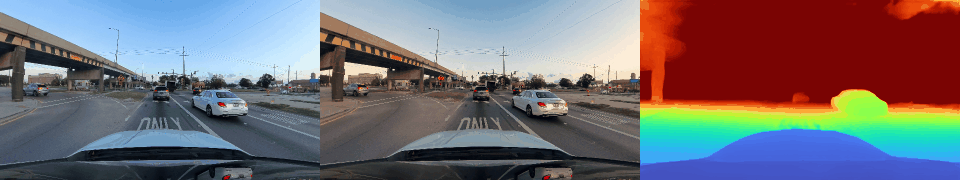
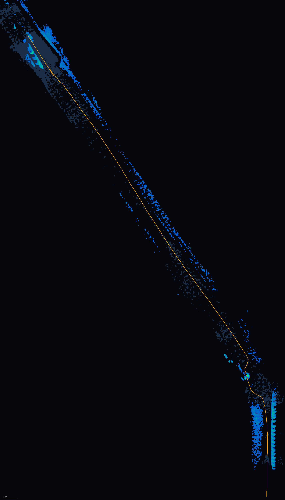
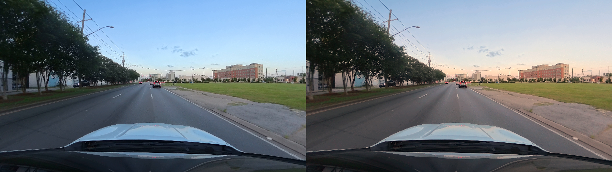
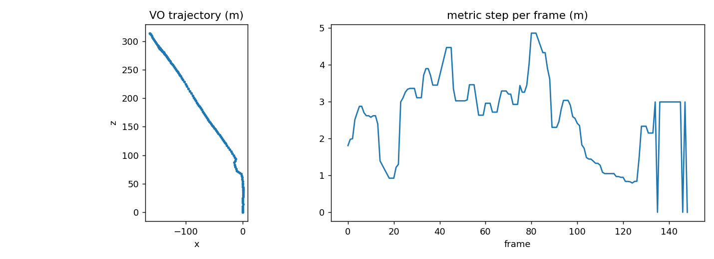

# BEV_SIMULATION_ISP

Monocular visual odometry and bird's-eye-view (BEV) occupancy from a single camera, with an ablation of an adaptive image signal processing (ISP) front end on night and rain clips. The recovered trajectory and predicted depth are then fed into RTAB-Map (ROS 2 Lyrical) to build a fused 3D point-cloud map.



## What this project does

1. **Visual odometry + BEV.** Metric-scale trajectory and a BEV occupancy map from monocular video, using predicted depth.
2. **ISP ablation.** Compares raw frames against ISP variants (denoise, white balance, gamma, CLAHE) on night and rain footage, measuring depth error (AbsRel), trajectory error (ATE) and path-length error.
3. **RTAB-Map mapping.** The notebook's frames, predicted depth and poses are packed into a rosbag2 and fused into a point cloud with RTAB-Map.

| BEV + trajectory | ISP before / after |
|---|---|
|  |  |



## Results

Numbers below are from my run; the full table is in `isp_eval.md` / `isp_eval.csv`.

| Condition | AbsRel | ATE (m) | Path length error |
|---|---|---|---|
| night / raw | 0.093 | 13.4 | -13.8% |
| night / full ISP | 0.292 | 20.8 | -39.3% |

- Metric scale works: median step 2.93 m per frame, 387 m total path on the clip. TODO: state the real speed of the clip to confirm.
- **The full ISP did not help on night footage.** It was worse than raw on depth, ATE and path length. The extra features it produced were mostly amplified noise.
- The noise floor is high: a nearly identical image (clean + WB/gamma) still showed about 5.5 m ATE, so ATE gaps below roughly 5 to 10 m are not evidence of anything.
- Rain was roughly a wash.
- TODO: add the denoise-first ISP variant row if you ran it.

## RTAB-Map map


TODO: add a screenshot, and a Sketchfab link for the interactive cloud.

How it was built, and what did not work:

- RTAB-Map's own visual odometry **failed to track this clip** (too few inliers per frame). Likely causes: night imagery, roughly 5 fps with about 2.9 m between frames, and depth that is predicted rather than measured.
- So the notebook's VO poses were supplied to RTAB-Map as external odometry (`/odom`). RTAB-Map therefore did mapping and pose-graph optimisation here, not odometry. Comparing its exported poses against the notebook poses would only compare my input to itself, so I do not claim that as validation.
- Depth is predicted from a single image, so the map's metric accuracy depends on the depth model, not on RTAB-Map.
- A single straight road has no loop closures, so RTAB-Map's loop-closure strength is not exercised.
- Point cloud export needs `--max_range 0`; the default 4 m range cap leaves the cloud almost empty with predicted depth.

## Reproduce the RTAB-Map step

Tested on Ubuntu 26.04 (WSL2) with ROS 2 Lyrical.

```bash
sudo apt install ros-lyrical-ros-base ros-lyrical-rtabmap-ros python3-opencv python3-scipy
source /opt/ros/lyrical/setup.bash

# notebook export (rtabmap_export/) -> rosbags
python3 make_bag.py rtabmap_export ghost_bag
python3 make_odom.py rtabmap_export/poses_tum.txt odom_bag

# merge into one bag
cat > merge.yaml << 'EOF'
output_bags:
- uri: merged_bag
  storage_id: sqlite3
  all_topics: true
EOF
ros2 bag convert -i ghost_bag -i odom_bag -o merge.yaml
```

Then, in separate terminals (each sourced):

```bash
# T1: optical frame -> base_link
ros2 run tf2_ros static_transform_publisher --x 0 --y 0 --z 0 --yaw -1.5707963 --pitch 0 --roll -1.5707963 --frame-id base_link --child-frame-id camera_optical_frame --ros-args -p use_sim_time:=true

# T2: RTAB-Map using external odometry
ros2 launch rtabmap_launch rtabmap.launch.py \
  rgb_topic:=/camera/image_raw depth_topic:=/camera/depth camera_info_topic:=/camera/camera_info \
  frame_id:=base_link approx_sync:=false use_sim_time:=true \
  visual_odometry:=false odom_topic:=/odom rtabmap_viz:=true \
  args:="-d --Rtabmap/DetectionRate 0 --Grid/DepthMax 80 --Grid/RangeMax 0 --Grid/DepthDecimation 2"

# T4: publish /odom as TF
python3 odom_tf.py --ros-args -p use_sim_time:=true

# T3: play
ros2 bag play merged_bag --clock -r 0.25
```

Export after pressing Ctrl+C in T2:

```bash
rtabmap-export --cloud --max_range 0 --voxel 0.05 --decimation 2 ~/.ros/rtabmap.db
```

Note: `make_bag.py` has `id=0` in `TopicMetadata` because the Lyrical `rosbag2_py` API requires it.

## Files

| File | Purpose |
|---|---|
| `*.ipynb` | Main notebook: VO, BEV, ISP ablation, export |
| `make_bag.py` | Packs RGB, depth and camera info into a rosbag2 |
| `make_odom.py` | Converts TUM-format poses into `/odom` for RTAB-Map |
| `odom_tf.py` | Republishes `/odom` as an `odom` to `base_link` TF |
| `isp_eval.md`, `isp_eval.csv`, `summary.json` | Ablation results |

Large data (frames, depth, bags, full point cloud) is not stored in this repo.

## Limitations and next steps

- Single clip per condition; no repeated runs, so no confidence intervals.
- Predicted depth, no ground-truth scale beyond the speed check.
- Record a block loop to exercise loop closure and to give RTAB-Map's own odometry a fair test (daytime, higher frame rate).
